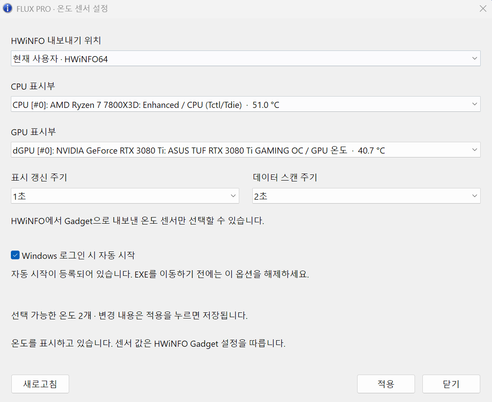
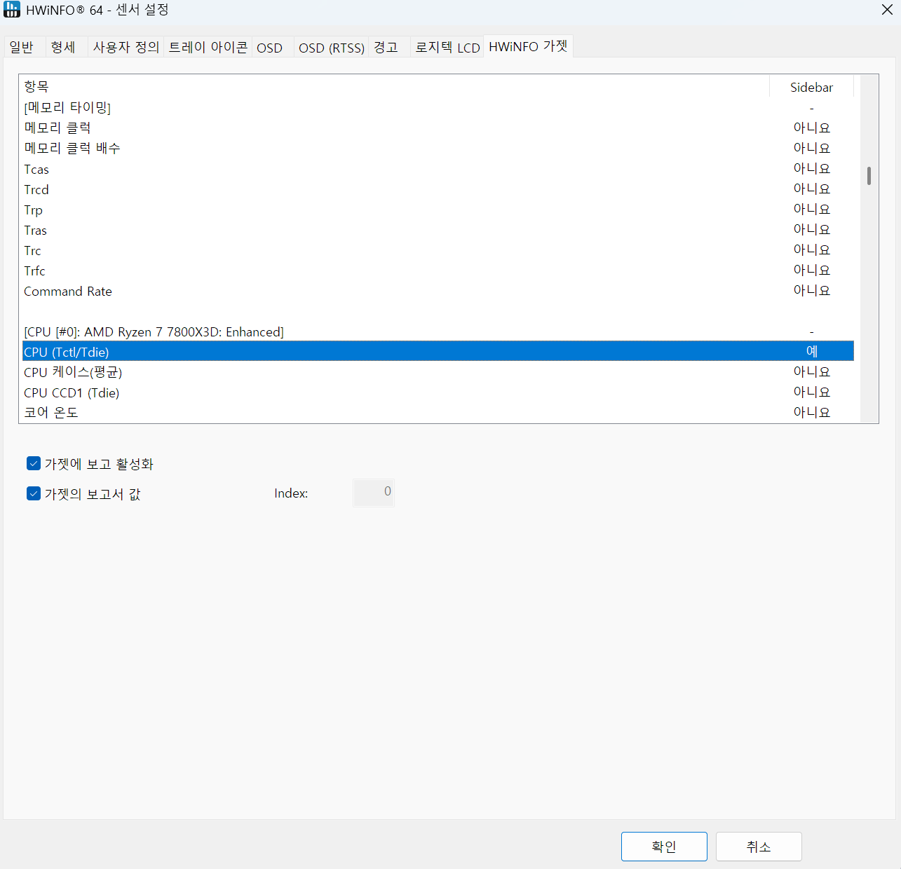
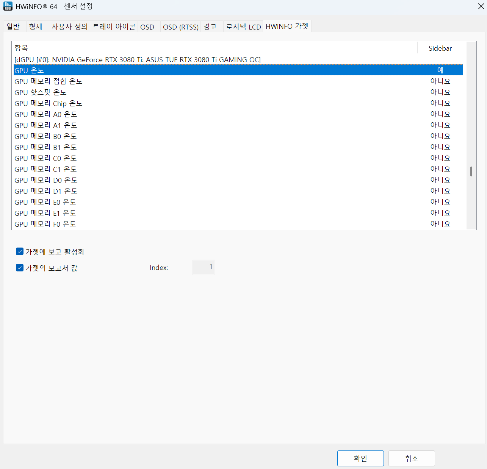

# hwinfo-flux-pro

HWiNFO의 CPU·GPU 온도를 Antec FLUX PRO 케이스 표시부에 보내는 Windows용
비공식 유틸리티입니다. 트레이에서 센서와 갱신 주기, 자동 시작을 설정합니다.



## 사용하기

필요한 환경: **Windows x64**, **Antec FLUX PRO**, **HWiNFO의 Gadget 출력**.
HWiNFO는 별도로 설치하며, 이 프로그램과 함께 센서 모드로 실행해 두세요.
iUnity 등 표시부를 제어하는 다른 프로그램은 종료합니다.

1. 배포 ZIP을 원하는 폴더에 풉니다.
2. HWiNFO의 **센서 설정 → HWiNFO Gadget**에서
   **가젯에 보고 활성화(Enable reporting to Gadget)**를 켭니다. 사용할 CPU·GPU
   온도 항목을 각각 선택해 **가젯의 보고서 값(Report value in Gadget)**도 켭니다.
3. `hwinfo-flux-pro.exe`를 실행합니다.
4. **HWiNFO 내보내기 위치**, **CPU 표시부**, **GPU 표시부**를 선택하고
   **적용**을 누릅니다. 처음 설정한 뒤에는 트레이 메뉴에서 **표시 시작**을
   선택합니다. 이미 표시 중이면 변경 내용이 자동 반영됩니다.
5. HWiNFO에서 출력 센서를 추가하거나 변경했으면 **새로고침**을 누릅니다.

<details>
<summary>HWiNFO CPU·GPU 설정 화면 보기</summary>

CPU 온도를 선택하고 두 체크박스를 켠 예시입니다. 선택한 행의 **Sidebar**가
**예**로 표시됩니다.



GPU 온도도 같은 방식으로 선택해 보고를 켭니다.



센서 이름과 Index는 예시입니다. **Index를 0·1로 맞출 필요는 없습니다.**

</details>

- 기본 주기: **표시 갱신 1초 / 데이터 스캔 2초**. 표시 갱신은 1초를 권장합니다.
- 표시부에는 소수점 이하를 버린 온도를 보냅니다. 예를 들어 `42.9°C`는
  `42.0°C`, `100°C 이상`은 `99.0°C`로 표시합니다. 센서 미수신·0도·음수·
  1도 미만은 해당 칸을 표시 불가로 처리합니다. 선택 목록에는 원래 측정값이 표시됩니다.
- 설정 창을 닫아도 트레이에서 계속 동작합니다. 아이콘 클릭 또는 우클릭 →
  **센서 설정**으로 다시 열고, 우클릭 메뉴에서 표시 중지·종료를 선택합니다.
- **Windows 로그인 시 자동 시작**을 체크하면 즉시 등록되며, 다음 로그인부터
  설정 창 없이 트레이로 실행됩니다. HWiNFO의 자동 시작은 별도로 설정하세요.
- EXE를 이동하거나 교체하기 전에는 기존 EXE에서 자동 시작을 해제하고,
  새 위치의 EXE에서 다시 켭니다.

설정 파일은 `%LOCALAPPDATA%\hwinfo-flux-pro\config.json`에 저장됩니다.
HWiNFO 창도 숨기려면 **Sensors-only(센서 전용)** 모드와
**시작 시 센서 최소화**를 사용하세요. Gadget 출력은 계속 켜 둡니다.

## 빌드하기

Windows에서 다음 도구를 준비합니다.

- Rust와 rustup — 저장소의 `rust-toolchain.toml`에 지정된 버전을 사용합니다.
- Visual Studio Build Tools — **C++를 사용한 데스크톱 개발**과 Windows SDK.

저장소 루트의 PowerShell에서 실행합니다.

```powershell
.\scripts\build-release.ps1
```

실행 파일: `target\x86_64-pc-windows-msvc\release\hwinfo-flux-pro.exe`
빌드 스크립트는 실행 파일에 들어가는 로컬 빌드 경로를 일반 경로로 치환합니다.

EXE·ZIP·체크섬·라이선스 고지를 함께 패키징하려면 다음 명령을 사용합니다.

```powershell
.\scripts\package-release.ps1
```

결과는 `dist\hwinfo-flux-pro-<버전>-x86_64-pc-windows-msvc\`에 생성됩니다.
같은 버전의 폴더가 이미 있으면 덮어쓰지 않고 중단합니다.

소스 검사와 테스트:

```powershell
cargo fmt --check
cargo clippy --locked --all-targets --target x86_64-pc-windows-msvc -- -D warnings
cargo test --locked --target x86_64-pc-windows-msvc
```

## 라이선스

자체 코드는 [MIT](LICENSE)입니다. 배포 시 `LICENSE`, `THIRD-PARTY-NOTICES.txt`,
`RUST-THIRD-PARTY-NOTICES.html`을 함께 제공하세요.
